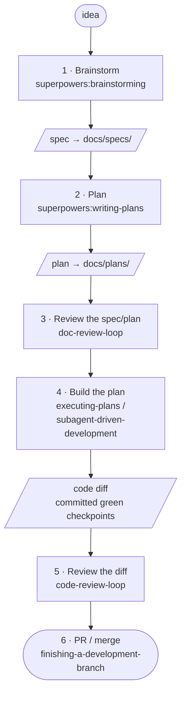
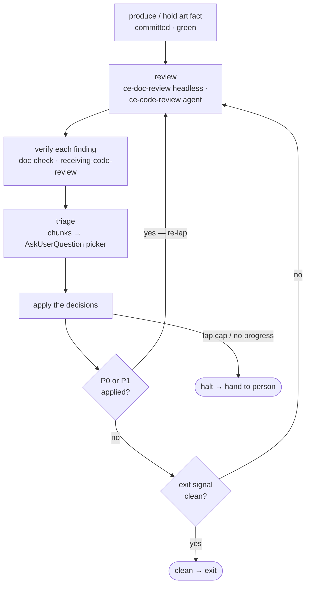

# The flow — brainstorm → merge

> **Historical — a snapshot of 2026-07-21, not the current state.** Kept for the
> build narrative. For how the plugin works today see the [README](../README.md),
> the [design spec](specs/2026-07-20-spec-triage-loop-plugin.md), the
> [plan](plans/2026-07-20-spec-triage-loop-plugin-plan.md) and [TODO.md](../TODO.md).

> The full brainstorm→merge sequencer (`before-pr`) is **staged to v1.1** (see `TODO.md`).
> This document is its blueprint, drawn from the spec (`§4` the loop, `§6` the family rule).
> v1 ships the two review loops + the hook; the spine below is how they compose end to end.

## End-to-end spine

## The inner review loop (steps 3 & 5 both run this)

The shared loop, written once in `skills/_shared/review-loop.md`. Both `doc-review-loop`
and `code-review-loop` bind four parameters into it (which review skill, which mode, the
exit signal, the verify check).

## How it composes

- **Steps 1–2 (brainstorm, plan):** the **superpowers** spine — `brainstorming` then
  `writing-plans`.
- **Steps 3 & 5 (reviews):** the shared loop above. Step 3 runs it with `doc-review-loop`
  (engine `ce-doc-review` in `mode:headless`); step 5 with `code-review-loop` (engine
  `ce-code-review` in `mode:agent`, verify via `receiving-code-review`).
- **The family rule (§6):** stay in **one family** for the brainstorm→plan lineage — default
  spine is superpowers; **compound-engineering = reviews only** (they read any doc, so
  they're family-neutral); execution is family-neutral.
- **`triage`** is what turns each review's surviving findings into an `AskUserQuestion`
  picker (chunks first, picker same turn) at steps 3 & 5.
- **Commit before review:** every artifact under review is a committed, green checkpoint —
  review runs on the committed diff, never the uncommitted tree.

## Where the steps live in the repo

| Concern | File |
| --- | --- |
| The inner review loop | `skills/_shared/review-loop.md` |
| Overall design (what ships · the loop · the family rule) | `docs/specs/2026-07-20-spec-triage-loop-plugin.md` (§2 · §4 · §6) |
| The build sub-steps | `docs/plans/2026-07-20-spec-triage-loop-plugin-plan.md` |
| The full brainstorm→merge sequencer | *not built — `before-pr`, staged to v1.1 (`TODO.md`)* |
